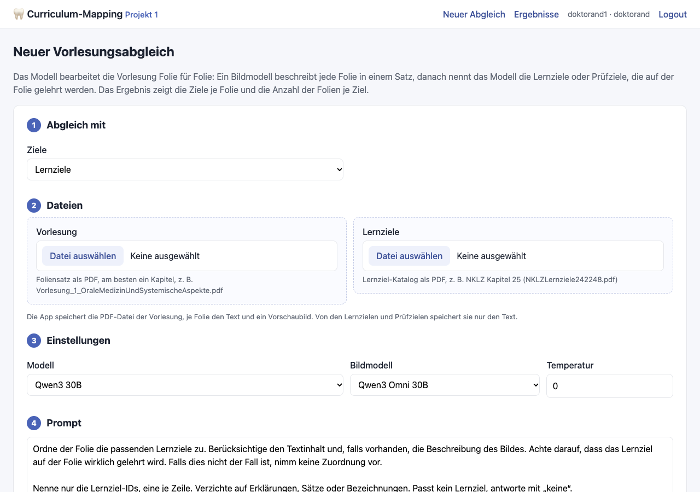
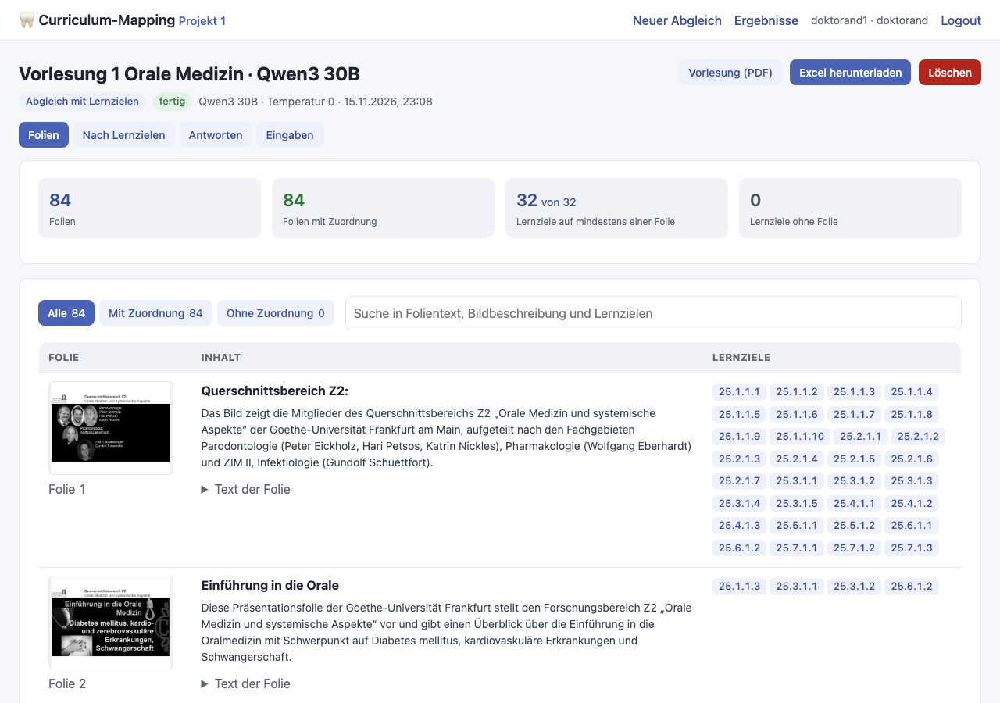
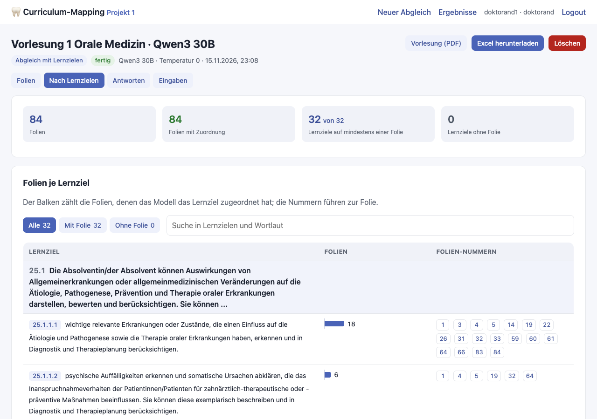

# Curriculum-Mapping (Projekt 1)

Web-Anwendung, die eine Vorlesung Folie für Folie mit Lernzielen oder
Prüfzielen abgleicht. Sie zeigt, welche Ziele auf welcher Folie gelehrt werden
und welche auf keiner Folie vorkommen.

Grundlage sind die Skripte in `projekt1/`: die Eingaben aus `UI.py`, die
Bildbeschreibung je Folie aus `vorlesung_preprocessing.py` und die Zuordnung
aus `vorlesung_lernziel_processing.py`. Wie dort entstehen eine Excel-Datei mit
den Zielen je Folie und die Anzahl der Folien je Lernziel.

## Seiten

| Seite | Inhalt |
| --- | --- |
| Neuer Abgleich | Vorlesung als PDF, Lernziele (Kapitel des NKLZ) oder Prüfziele (Kapitel des IMPP-Katalogs) als Datei, Modell, Bildmodell, Temperatur und Prompt |
| Ergebnisse | alle Abgleiche mit Status und Abdeckung |
| Abgleich | Kennzahlen, Folien mit Vorschaubild, Bildbeschreibung und zugeordneten Zielen; Anzahl der Folien je Ziel als Balken; Antworten des Modells; Eingaben; Excel-Export; fortsetzen, erneut ausführen und löschen |

Formulareingaben bleiben beim Neuladen als Entwurf im Browser erhalten
(`app/static/entwurf.js`), bis das Formular abgeschickt oder verworfen wird.
Dateien müssen nach dem Neuladen erneut ausgewählt werden.

## Ansichten

Neuer Abgleich:



Abgleich der Vorlesung 1 (Orale Medizin und systemische Aspekte) mit den
Lernzielen aus Kapitel 25 des NKLZ, Ergebnis von Qwen3 30B. Je Folie stehen
Vorschaubild, Bildbeschreibung und die zugeordneten Lernziele:



Dasselbe Ergebnis nach Lernzielen, mit der Anzahl der Folien je Lernziel:



## Einrichten und starten

Voraussetzung ist Python 3.11 oder neuer.

```bash
python3 -m venv venv
venv/bin/pip install -r requirements.txt
venv/bin/python -m scripts.init_db
venv/bin/flask --app app run --port 5002
```

`scripts.init_db` ohne Argument legt für den lokalen Testbetrieb den Login
`doktorand1` mit dem Passwort `doktorand1` an.
`venv/bin/python -m scripts.init_db NAME` legt einen Login mit abgefragtem
Passwort an.

## KI-Dienst

Die Anwendung nutzt einen OpenAI-kompatiblen Dienst, standardmäßig den
LiteLLM-Server der Goethe-Universität Frankfurt. Konfiguration über
Umgebungsvariablen:

| Variable | Bedeutung |
| --- | --- |
| `P1_LLM_API_KEY` | API-Schlüssel, ohne ihn startet kein Abgleich |
| `P1_LLM_URL` | Basis-URL, Standard `https://litellm.s.studiumdigitale.uni-frankfurt.de/v1` |
| `P1_LLM_MODELLE` | Modellauswahl, z. B. `mistral-large-3-675b-instruct-2512=Mistral Large 3,qwen3-235b-a22b=Qwen3 235B` |
| `P1_LLM_BILDMODELLE` | Modelle für die Bildbeschreibung, gleiches Format, Standard `qwen3-omni-30b-a3b-instruct` |
| `P1_LLM_MAX_TOKENS` | optionale Obergrenze für die Länge der Antwort |
| `P1_MAX_ZEICHEN` | Obergrenze für alle Texte eines Abgleichs, Standard 400000 |
| `P1_MAX_UPLOAD_MB` | Obergrenze in MB für alle Dateien eines Formulars, Standard 80 |
| `P1_MAX_FOLIEN` | Obergrenze für die Seitenzahl einer Vorlesung, Standard 200 |
| `COOKIE_SECURE` | `1` beim Betrieb hinter HTTPS |

Ein Abgleich läuft im Hintergrund. Die Ergebnisseite zeigt den Fortschritt und
lädt neu, sobald alle Folien bearbeitet sind. Höchstens zwei Abgleiche laufen
gleichzeitig. Ein Abgleich, der zehn Minuten kein Lebenszeichen gibt, gilt als
abgebrochen.

## Vorlesungsabgleich

Beim Anlegen speichert die Anwendung die PDF-Datei der Vorlesung und je Folie
den Text (pypdf) und ein Vorschaubild (pypdfium2). Ein Hintergrund-Thread
bearbeitet danach jede Folie einzeln:

1. Das Bildmodell beschreibt die gerenderte Folie in einem Satz
   („Interpretiere das Bild in einem Satz!“). Ohne Bildmodell entfällt dieser
   Schritt.
2. Das Modell erhält die Liste der Ziele, die Nummer der Folie, den Folientext,
   die Bildbeschreibung und den Prompt und nennt die passenden Lernziel-IDs
   oder Prüfziele (Teil und Nummer, z. B. `VI 1.2.4`).

Schlägt eine Anfrage fehl, wiederholt der Abgleich sie einmal. Meldet der
Dienst zu viele Anfragen (Status 429), wartet er vorher die verlangte Zeit,
höchstens zwei Minuten, ohne Angabe eine Minute. Jede Antwort wird sofort
gespeichert. Bricht ein Abgleich ab, setzt „Fortsetzen“ bei der ersten offenen
Folie wieder ein. „Erneut ausführen“ legt einen neuen Abgleich mit derselben
Vorlesung an und übernimmt die Bildbeschreibungen, wenn das Bildmodell gleich
bleibt.

Abgeglichen wird entweder mit den Lernzielen eines NKLZ-Kapitels (IDs wie
25.1.1.1; IDs mit Unterpunkten wie 25.1 sind Überschriften) oder mit den
Prüfzielen aus einer Datei (PDF, TXT oder MD), etwa einem Kapitel des
IMPP-Katalogs. Aus der Prüfziel-Datei werden Zeilen mit Nummer und Name
gelesen, etwa `VI.1.1.1 Karies` oder `1.1.1 Karies`; Seitenzahlen und
Fließtext bleiben außen vor. Die Datei mit den Zielen darf höchstens
`P1_MAX_ZEICHEN` Zeichen haben. Angaben, die nicht in der Liste stehen, sind
rot markiert und werden gesondert gezählt.

## Aufbau

Die Anwendung ist eine Flask-App mit zwei Blueprints: `auth` (Anmeldung) und
`folien` (Vorlesungsabgleich). Gemeinsame Bausteine liegen direkt in `app/`.

| Datei | Aufgabe |
| --- | --- |
| `app/__init__.py` | App-Factory: Konfiguration, Blueprints, Fehlerseiten, Template-Filter |
| `app/config.py` | Einstellungen aus Umgebungsvariablen (KI-Dienst, Grenzen) |
| `app/db.py`, `app/schema.sql` | SQLite-Datenbank und Schema |
| `app/auth.py`, `app/security.py` | Anmeldung, CSRF-Schutz, Tokens, Sicherheits-Header |
| `app/ki.py` | Anfragen an den KI-Dienst |
| `app/hintergrund.py` | Abgleiche im Hintergrund-Thread, Höchstzahl, Abbruch nach Zeitgrenze |
| `app/pruefziele.py` | Prüfziel-Listen aus dem Text einer Datei lesen |
| `app/lernziele.py` | Lernziele eines NKLZ-Kapitels und Lernziel-IDs in Texten |
| `app/dokumente.py`, `app/eingaben.py` | Text aus PDF- und Textdateien, Prüfung der Formulareingaben |
| `app/excel.py`, `app/formate.py` | Bausteine für den Excel-Export, deutsche Schreibweise von Datum und Zahlen |
| `app/seiten.py`, `app/fehler.py` | gemeinsame Bausteine der Seiten, Fehler mit Meldung für die Oberfläche |
| `app/folien/` | Folien aus der PDF-Datei, Liste der Ziele, Ablauf je Folie, Auswertung, Export, Seiten |
| `app/templates/`, `app/static/` | Seiten, Stylesheet, Skripte als ES-Module (Entwurf, Tabellenfilter, Fortschritt) |
| `scripts/init_db.py` | Datenbank und Login anlegen |
| `tests/` | pytest-Tests mit lokalem Test-Server für den KI-Dienst |
| `docs/screenshots/` | Bildschirmfotos für den Abschnitt [Ansichten](#ansichten) |

Die Seiten enthalten kein eigenes Skript; `app/static/seiten.js` richtet alle
Bausteine über `data`-Attribute ein. Die Content Security Policy lässt deshalb
nur Skripte aus `app/static/` zu.

## Tests und Codeprüfung

```bash
venv/bin/pip install -r requirements-dev.txt
venv/bin/python -m pytest --cov
```

Die Tests laufen ohne Netzwerkzugriff gegen einen lokalen Test-Server für den
KI-Dienst und prüfen Upload, den Ablauf je Folie, Auswertung, Export,
Sicherheit und Fehlerfälle. Die Abdeckung muss mindestens 95 % betragen.

Die Codeprüfung (ruff, djLint, sqlfluff, stylelint) läuft über pre-commit, Aufruf
im App-Ordner:

```bash
uvx pre-commit run --all-files
```

pre-commit prüft außerdem die Skripte mit ESLint und die Markdown-Dateien mit
markdownlint. Typen, Stil, Sicherheit und Abhängigkeiten:

```bash
venv/bin/python -m mypy
venv/bin/python -m pylint app scripts tests
venv/bin/python -m bandit -c pyproject.toml -r app scripts
venv/bin/python -m vulture
venv/bin/python -m pip_audit -r requirements.txt
```
